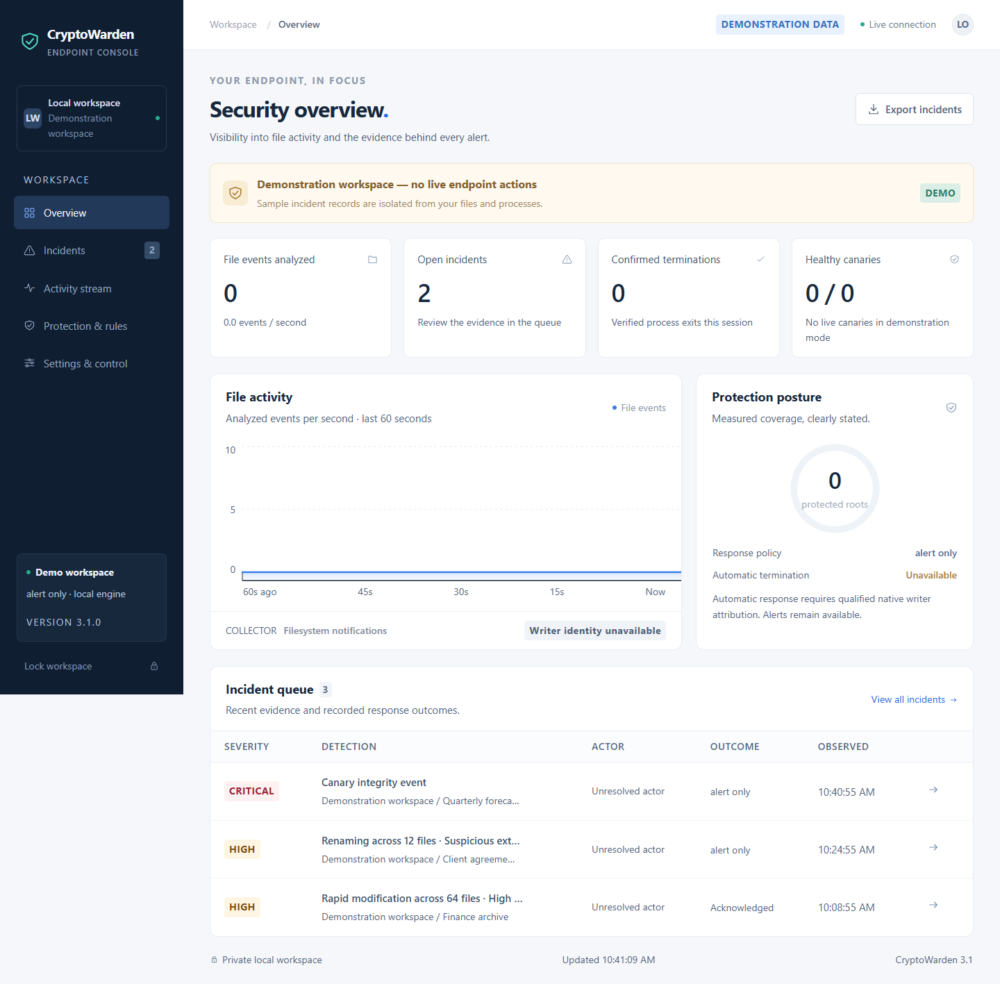

# CryptoWarden 3.1

Local endpoint file monitoring, durable incident evidence, and guarded operator response.

CryptoWarden watches configured directories for canary integrity events and suspicious multi-file behavior. Its console shows live activity, incident evidence, collection health, and recorded action results. The console and charts work without external fonts, scripts, or cloud services.

**Release status:** hardened monitoring/response candidate. The shipped watchdog collector reports file changes without an authenticated writer identity. Automatic termination is unavailable. This prevents unrelated applications from being killed based on coincidental I/O. Industry deployment qualification is tracked in [the release gates](docs/RELEASE_GATES.md).



## Install

Windows 10/11 and Python 3.11+ are the primary target. Node 22+ is needed only for dashboard development/browser tests. Linux checks are useful for portability but do not establish Windows field qualification.

```powershell
python -m venv .venv
.venv\Scripts\python -m pip install --require-hashes -r requirements.txt
.venv\Scripts\python -m src.main check
```

Edit [config.yaml](config.yaml) before the first start. Protected directories must already exist, be local, and avoid reparse points. Relative paths resolve against the configuration file, not your shell's current directory. Invalid configuration is rejected. If a previously configured directory becomes unavailable, collection reports a fault and the console remains available for recovery. Legacy process-name whitelists are rejected; executable basenames cannot establish trust.

```powershell
.venv\Scripts\python -m src.main start
```

Open [the local console](http://127.0.0.1:8001/) and enter the access key printed by the engine. The key is never put in a URL or written to the engine log. You can instead supply a secret of at least 32 characters through `CRYPTOWARDEN_DASHBOARD_TOKEN`. Empty configured tokens generate a new random key for each start; they never disable authentication.

Opening `dashboard/index.html` directly shows a styled file preview with a link to the running console. Sign-in and live monitoring require the engine's HTTP address.

To use a separate configuration:

```powershell
.venv\Scripts\python -m src.main start --config C:\path\to\endpoint.yaml
```

The listener accepts only loopback IPs. HTTP-only SameSite cookies, exact Host/Origin checks, CSRF validation, session expiry, request size/rate limits, and a push-only WebSocket stream protect console operations. Do not expose this listener through a network proxy.

## Console

- **Overview:** analyzed event counts, open incidents, confirmed exits, canary health, activity trend, and current posture.
- **Incidents:** search/filter retained records, inspect evidence, acknowledge review, and export records.
- **Activity stream:** bounded recent observations; pausing the view does not stop monitoring.
- **Protection & rules:** actual directory scope, canary status, queue/loss/analysis metrics, executable review records, and process I/O context.
- **Settings & control:** pause/start collection, timed pauses with automatic resume, collector restart, editable protected roots and exclusions, detection tuning, and response policy. Changes require a reason, review of before/after values, coverage acknowledgment, and explicit typed confirmation when enabling manual termination.

Saved console policy persists in the private runtime database and takes precedence over the corresponding startup-file settings. Revisions prevent another session from silently overwriting your changes. A failed collector restart restores the previous policy; an interrupted transition starts paused for operator recovery. The console process stays available while collectors are paused. The listener, access key, private runtime location, and essential-process protections cannot be changed from the policy form.

To deliberately reset saved console policy to a startup configuration, stop the engine and use `start --config C:\path\to\endpoint.yaml --reset-policy`. `check` validates the startup file; it does not activate or replace saved console policy. See [management controls](docs/MANAGEMENT.md) for details.

An acknowledgment records review; it does not claim remediation. A disconnected console explicitly shows stale state. I/O context never identifies a file writer.

For an incident with an unresolved actor, an authenticated operator may explicitly select a currently observed process instance for investigation. The selection is recorded as `operator_selected`, never as proof that it wrote a file. If `response.mode: terminate` is deliberately configured, a separate operator request may terminate that captured process after revalidating PID, creation time, executable, critical status, and protection policy. Confirmed exits are counted only after waiting for the process. Alert-only/dry-run, refused, failed, already-exited, and partial outcomes stay distinct. Optional tree response preflights every captured descendant; it remains best effort against concurrent process creation.

Executable review records bind a full path and SHA-256 fingerprint to an operator reason. They are annotations, not broad detection bypasses; canary incidents remain visible.

## Safe demonstration

```powershell
.venv\Scripts\python -m src.main demo
```

Demo mode uses isolated sample records and disables live monitoring and process actions. Without a custom config it uses a separate `.cryptowarden-demo/` storage directory. With a custom config, choose a separate storage directory. The engine rejects mixing demo and live workspaces. Stop the engine with Ctrl+C before starting another instance on the same port.

To generate file-change patterns inside an already protected root, use:

```powershell
.venv\Scripts\python tests/ransomware_simulator.py --directory C:\path\to\protected-root --files 20
```

The simulator creates a fresh disposable subdirectory, changes only its own files, and cleans up that directory. It does not encrypt user data, select a kill target, or treat process survival as proof of failed detection. Check the incident journal.

## Canary ownership and cleanup

Canaries use collision-resistant names and exclusive creation. Their normalized paths, file identity, and content fingerprints are stored in an ownership manifest. Existing legacy filenames such as `private_keys.key` are never adopted, hidden, or deleted.

```powershell
# Preview unchanged owned files eligible for removal
.venv\Scripts\python tools/cleanup_honeypots.py
# Apply only while the engine is stopped
.venv\Scripts\python tools/cleanup_honeypots.py --apply
```

Changed, replaced, unreadable, or unsafe canaries are retained for review. A missing or changed canary degrades health and generates an incident; the engine does not silently erase the evidence or replace user content.

## Data and operations

The default `.cryptowarden/` directory contains:

| Artifact | Purpose |
| --- | --- |
| `incidents.sqlite3` | Incident evidence, review records, action audit, and durable command replay protection |
| `canaries.json` | Owned canary manifest |
| `engine.log*` | Rotating diagnostic logs |
| `engine.lock` | OS-held single-instance lock |

The directory receives a private Windows DACL for the current SID and SYSTEM, or mode 0700 on POSIX. Incidents expire after 30 days and are capped at 10,000 by default. Command idempotency records use the configured retention horizon; a pending outcome after interruption is refused on replay and requires review. Exports contain sensitive local paths; store them appropriately.

Queue overflow and analysis failure degrade health. There is no claim that dropped events were recovered. Startup verifies watched scope and component readiness; background service failure stops the engine and disconnects the console. Use a supervised, separately qualified service deployment for unattended operation.

There is no file rollback, protected backup, Windows driver, anti-tamper service, or certified prevention guarantee. See [SECURITY.md](SECURITY.md) for the boundaries.

## Develop and validate

```powershell
.venv\Scripts\python -m pip install --require-hashes -r requirements-dev.txt
.venv\Scripts\python -m pytest --cov=src --cov-fail-under=80
.venv\Scripts\python -m ruff check src tests tools
.venv\Scripts\python -m ruff format --check src tests tools
npm ci --ignore-scripts
npm run format:check
npm run test:ui
.venv\Scripts\python -m build --no-isolation
```

Browser tests use installed Edge on Windows; on Linux, install Chromium with `node node_modules/@playwright/test/cli.js install --with-deps chromium`. Tests prohibit real process kills and use disposable directories. Their live integration starts watchdog and the console only against a temporary root.

Runtime and development locks pin exact versions with release hashes. Regenerate only from an intentional environment using `tools/lock_dependencies.py`, review changes, audit dependencies, and rerun the compatibility matrix. Do not install a production runtime from unconstrained latest versions.

The wheel bundles console assets and exposes a `cryptowarden` CLI. Supply an explicit writable configuration/storage directory when using an installed wheel. The source archive includes configuration, test fixtures, locks, and operational documentation. After upgrading a running 3.0 process, restart it once to load the 3.1 backend and assets; subsequent policy changes are managed from the console.

## Architecture and audit

Filesystem observer → bounded priority intake → scoped unique-file windows + bounded entropy sampling → explainable detection → durable incident journal → independent dashboard delivery.

Operator command → authenticated session + CSRF → persistent request reservation → captured process revalidation → guarded action → confirmed structured outcome.

The original [audit](audit/AUDIT.md) and its evidence describe revision `e100d34`. [Remediation status](audit/REMEDIATION.md) records the 3.0 hardening baseline; the [3.1 management upgrade](audit/MANAGEMENT_UPGRADE.md) records the new controls and typography with current validation.
